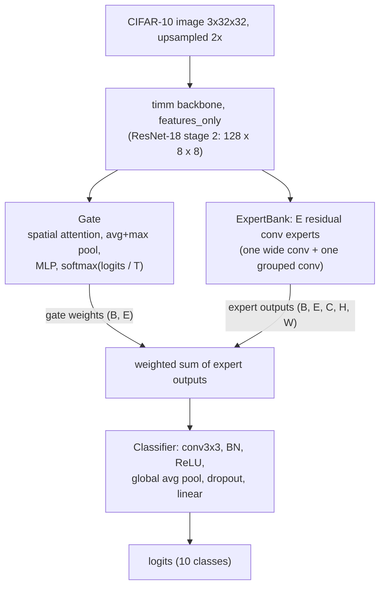
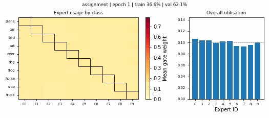
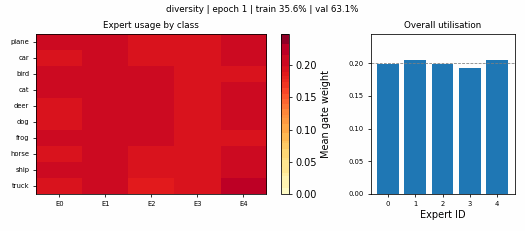
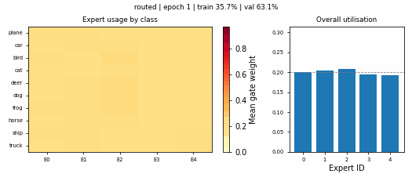

# timm-moe
## Mixture of experts on top of pretrained timm image models

This repo shows how a [timm](https://github.com/huggingface/pytorch-image-models) model used as a
feature extractor (`features_only=True`) can feed a mixture of experts (MoE) for classification.
Training and testing use CIFAR-10. The default backbone is ResNet-18 up to stage 2 on 2x upsampled
images; any timm CNN that supports `features_only` works via `--backbone` / `--out-index`.



## Results
Full runs, 30 epochs, default settings. Checkpoint selection and early stopping use a 5k validation
split held out of the training set; the test set is only reported, using the best-validation checkpoint.

| variant      | experts | best val | **test** | what the gate learns |
|--------------|---------|----------|----------|----------------------|
| `diversity`  | 5       | 93.52%   | **92.82%** | near-uniform use of every expert for every class (acts like a soft ensemble) |
| `assignment` | 10      | 93.10%   | 92.57%   | the label-assigned expert per class (supervised), still evenly utilised |
| `routed`     | 5       | 92.02%   | 91.19%   | each class picks one expert, discovered without labels in the gate |

**Best model: `diversity`** (highest validation accuracy). `assignment` and `routed` give up a little
accuracy for gates that actually specialise, which is the more interesting MoE behaviour. Per-epoch
logs are in [`assets/logs/`](assets/logs) (train / val / test accuracy, seconds, every loss term).
Single seed, so the gap between `diversity` and `assignment` is within noise.

## Expert utilisation during training
Every epoch the class -> expert usage matrix (on the validation split) is recorded and rendered as an
animation: a heatmap of the mean gate weight each expert gets per class (squares mark the assigned
expert in the `assignment` variant) and the overall expert utilisation (dashed line = perfectly even).

**`assignment`** – labels pre-assign classes to experts; the diagonal emerges as training proceeds.



**`diversity`** – no specialisation: usage stays near uniform.



**`routed`** – classes split across the experts on their own, into semantically sensible pairs:
bird+frog, deer+horse, cat+dog, plane+ship, car+truck.



A run writes `usage.gif` (plus `usage.mp4` when `ffmpeg` is on the PATH) and `usage_final.png` into its
output folder. Re-render a finished run with `python -m moe.animate runs/assignment --assignment`.

## Quick start
```
pip install -r requirements.txt
python train.py --variant diversity            # 30 epochs, early stopping patience 8
python train.py --variant assignment --epochs 50 --patience 10
python -m pytest tests
```
CIFAR-10 is downloaded to `./data`. Every run writes to `runs/<variant>/`: `metrics.csv`,
`best_model.pth` (best validation epoch), `usage_history.npz` and the animation.
The reported runs took 30-50 s/epoch on a heavily throttled laptop GPU (Quadro RTX 5000 Max-Q);
an unthrottled GPU is considerably faster.

## Variants
All variants share the model and training loop; they differ in the auxiliary losses (`moe/config.py`).

| variant      | experts | auxiliary losses (weight)                     | idea |
|--------------|---------|-----------------------------------------------|------|
| `assignment` | 10      | balance 0.1, routing 0.1, diversity 0.1       | Labels pre-assign classes to experts and the gate is supervised towards that assignment. |
| `diversity`  | 5       | balance 0.1, diversity 0.1                    | Plain MoE; experts are pushed apart and kept evenly used. |
| `routed`     | 5       | balance 1.0, specialization 1.0               | Plain MoE; each class is encouraged to stick to few experts. |

Losses (`moe/losses.py`), each `0` at its optimum:
* **balance** – mean gate usage vs uniform (`E * sum(usage^2) - 1`).
* **routing** – cross entropy between the gate and the expert assigned to the sample's class.
* **diversity** – mean pairwise cosine similarity between different experts' outputs.
* **specialization** – mean entropy of each class's expert distribution.

Specialization alone is trivially minimised by sending everything to one expert (balance hit its
maximum, 4.0, in a test with specialization weight 1 and balance 0.1), so its balance weight must
dominate. That is why `routed` uses balance 1.0.

## Training details
* Held-out validation split (5k of the 50k training images) drives checkpoint selection and
  **early stopping** (`--patience`, default 8 epochs without validation improvement). None of the
  reported 30-epoch runs triggered it; validation accuracy was still creeping up at the end.
* **Scheduler:** one-cycle with AdamW, warmup to the peak lr over the first 20% of steps then cosine
  decay to ~0; `1e-4` for the pretrained backbone, `2e-4` for gate/experts/classifier; gradient clipping at 1.0.
* Images are upsampled 2x before the backbone (`--input-scale`); see the architecture search below.
* Mixed precision (fp16 autocast) by default; `--no-amp` disables it.
* CIFAR-10 and its augmentation (crop, flip, cutout) live on the GPU, so there are no dataloader workers.
* The experts run as one fused module (a wide conv plus a grouped conv), mathematically identical to
  independent experts but with far fewer kernel launches.

## Architecture search
12 epochs each, `assignment` variant, one-cycle compressed to 12 epochs, selected on validation accuracy.
Single seed, so differences under about 0.5 points are noise.

| change                                         | best val | test @ best val |
|------------------------------------------------|----------|-----------------|
| EfficientNet-B2 stage 1, native 32px (original code) | –  | 80.1% (10 epochs, no val split) |
| ResNet-18 stage 2, native 32px (baseline)      | 84.9     | 84.7            |
| + residual connection around the MoE           | 84.3     | 84.3            |
| + label smoothing 0.1                          | 85.0     | 85.0            |
| + wider experts (256)                          | 85.4     | 85.5            |
| ResNet-34 stage 2, native 32px                 | 86.3     | 85.7            |
| **ResNet-18 stage 2, 2x upsampled (default)**  | **92.4** | **91.5**        |
| 2x + ResNet-34                                 | 93.0     | 92.2            |
| 2x + residual connection                       | 91.8     | 91.1            |
| 2x + backbone stage 3                          | 91.6     | 90.4            |
| 3x upsampled                                   | 92.7     | 92.3            |

Upsampling is the one change that matters: a pretrained backbone wants more than 32 px. ResNet-34 and
3x add roughly 0.4-0.6 points for 2x or more compute, so they are left as options
(`--backbone resnet34`, `--input-scale 3`).

## Layout
```
train.py          CLI entry point
moe/config.py     variants (experts, temperature, loss weights)
moe/data.py       CIFAR-10 held on the GPU, train/val/test split, GPU-side augmentation
moe/model.py      ExpertBank, Gate, MoEClassifier
moe/losses.py     auxiliary losses
moe/engine.py     optimizer/schedule, early stopping, train epoch, evaluation (+ usage matrix)
moe/animate.py    usage animation (GIF / MP4) and static final plot
tests/            unit tests (no downloads needed)
assets/           README animations and per-epoch training logs
```

## Contributors
* **wajih** – author and maintainer.
* **Claude** (Anthropic) – code review, refactor into the `moe` package, bug fixes (see below), GPU data
  pipeline, mixed precision, validation split and early stopping, architecture search, usage animation,
  tests and documentation.

## What the review fixed
* Gate temperature was learnable and divided only in training mode (`training=True` default), so
  train and eval gates differed; it is now a constant applied everywhere.
* In the assignment variant the label-guidance mix factor was `sigmoid(temperature)` (about 1 for
  temperature 10), so the guidance was dead code, and it leaked labels into the forward pass. Routing
  is now supervised only through the routing loss.
* The assignment variant's diversity loss ran KL divergence on raw gate probabilities (not
  log-probabilities) and was minimised negatively, so it was unbounded. It is now a bounded cosine
  similarity of expert outputs.
* The routed variant's specialization loss was constant (`|corr - 0.5|` with all `corr < 0.5`), and its
  balance target summed to 0.5 instead of 1. Both replaced.
* The best checkpoint was chosen on the test set; it is now chosen on a held-out validation split.
* Per-step NaN checks forced a GPU sync every iteration; removed.
* `viz.py` imported seaborn without listing it, plotted a single test batch (classes could be missing,
  giving NaN) and shadowed imports; replaced by `moe/animate.py` (matplotlib only, whole split).
* Dataloader workers were re-spawned each epoch on Windows; data now lives on the GPU.
* The README stated learning rates (3e-4) that the one-cycle schedule silently overrode (2e-4).
* Three near-identical 350-line scripts collapsed into one package and one CLI; the stale
  architecture diagram (EfficientNet-B0, 8 experts) was replaced.
